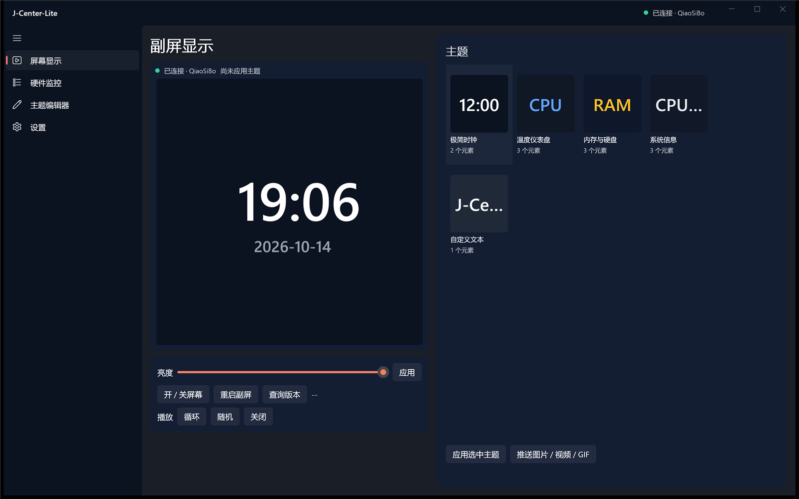
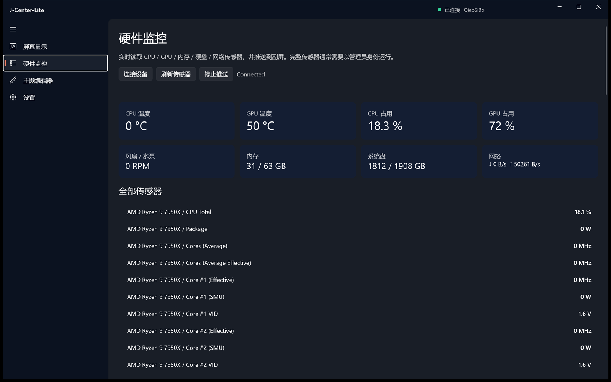
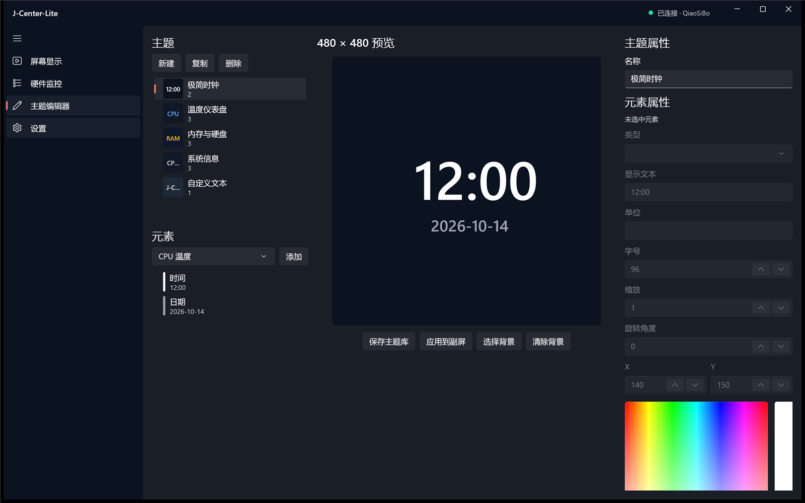
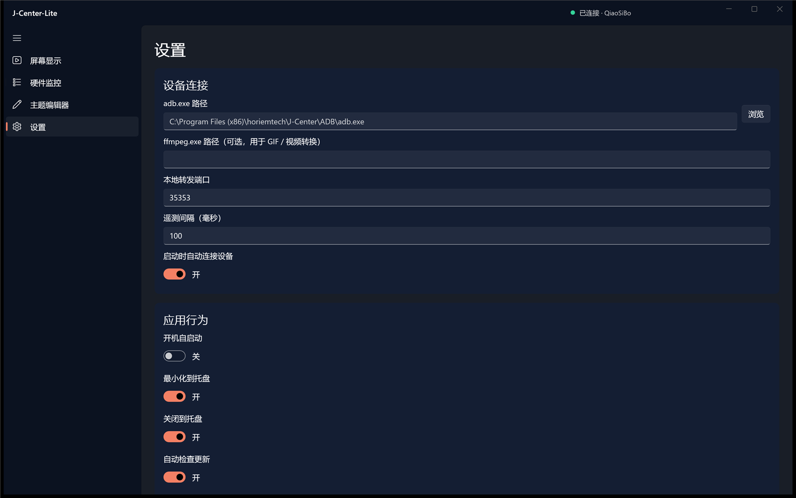

# J-Center-Lite

J-Center-Lite is an independent WinUI 3 reimplementation of the SEGOTEP / horiemtech **J-Center** control panel for QiaoSiBo 480×480 Android display modules and PC cooling hardware.

> 独立实现、不附带厂商二进制。原程序只用于行为与协议研究；仓库不包含原程序的代码、驱动、字体、图片、视频或固件。

## 作者自述

> 我是自己嫌那个驱动不太好用，重构了一下。

> *"I rebuilt it myself because I didn't like how the vendor driver worked."*

原厂 J-Center 能干活，但界面和交互都不太顺手——多主题、自定义媒体、位置微调这些每天都要用的东西，用起来很别扭。所以我按这块 480×480 屏幕自己的协议重新实现了一版：
不捆绑厂商二进制、不装额外驱动，用 ADB 直接接管屏幕；主题、媒体、传感器推送全部走本地，数据落在 `%LOCALAPPDATA%\JCenterLite`。
我实际用的设备是 **乔思伯 JONSBO TF2-360SC(WI)** 一体式水冷（480×480 IPS 屏，屏内 QiaoSiBo 模组），完整实测支持矩阵、固件限制和测试机配置见 [docs/device-support.md](docs/device-support.md)。

## 界面截图

| 副屏显示（默认首页） | 硬件监控 |
|---|---|
|  |  |

| 主题编辑器 | 设置 |
|---|---|
|  |  |

> 截图为演示主题库（应用内置的示例主题），不包含任何厂商素材或用户自备的媒体文件。

## 下载与安装

- 到 [Releases](https://github.com/pph6a/J-Center-lite/releases) 下载 `J-Center-Lite-1.0.0-win-x64.zip`，解压到任意目录后双击 `JCenterLite.exe` 即可。
  发布包是 **self-contained** 的：不需要预装 .NET 运行时，也不需要安装驱动或后台服务。
- 需要自备 **`adb.exe`**（Android platform-tools）：首次运行在“设置 → adb.exe 路径”里选一下；也可以直接指定原 J-Center 目录里自带的那份。
- 想让它出现在开始菜单：运行 `tools/install-start-menu-shortcut.ps1`。
- 目标平台：**Windows 11 x64**（Windows 10 1809+ 保留兼容）；要读全 CPU 温度/功耗/风扇建议以管理员身份运行。

> 首次连接时，如果原厂 J-Center 正在运行，应用会弹窗询问是否接管副屏（固件只允许一个控制连接）。

## 能做什么

- **硬件监控**：CPU/GPU 温度、占用、频率、功耗，内存、系统盘、网络上下行、风扇/水泵转速（LibreHardwareMonitor 驱动传感器）。
- **副屏推送**：每 100 ms 把传感器数据推送到 480×480 屏幕（含 CPU/GPU/内存/硬盘/网络/风扇等 34 个字段）。
- **副屏显示页（默认首页）**：左侧 480×480 实时画面（背景媒体 + 真实传感器数值，秒级刷新），右侧缩略图主题墙，单击缩略图即切换副屏主题。
- **屏幕控制**：亮度、循环/随机/关闭播放、开关屏、重启副屏、查询终端版本。
- **主题系统**：导入 PNG/JPG/GIF/MP4/WebM 背景；可视化 480×480 主题编辑器（时间/日期/温度/占用/内存/硬盘/网络等元素，可拖拽、旋转、缩放、改色、改字号）；一键推送到设备。
- **托盘与开机**：最小化/关闭到托盘、开机自启。
- **更新**：GitHub Releases 检查；发布包可直接放到 GitHub Release。
- **ADB 桥接**：自动查找 adb.exe，自动选空闲本地端口并建立到 `22222` 的转发；OTA 包可推送到 `/sdcard/ota_package/`。
- **占用检测与接管**：副屏固件只接受一个控制连接；如果原 J-Center 仍在运行，应用会明确提示，并在你确认后结束 `WFanManager.exe` 完成接管。

## 快速开始

1. 安装 Windows 11、[.NET 8 SDK](https://dotnet.microsoft.com/download/dotnet/8.0) 与 Visual Studio 2022（17.12+，含 Windows App SDK C# 桌面开发工作负载）。
2. 准备 `adb.exe`（Android platform-tools）。J-Center-Lite **不捆绑** adb；在“设置 → adb.exe 路径”中选择即可。
3. 用管理员身份运行 J-Center-Lite（LibreHardwareMonitor 读取 MSR/SuperIO 通常需要管理员权限；普通权限下仍可使用内存、磁盘、网络与部分 GPU 传感器）。
4. 连接 QiaoSiBo 屏幕模组，点击“连接设备”。设备出现后，点击“开始推送到副屏”。
5. 想把应用放进开始菜单（可选）：`powershell -ExecutionPolicy Bypass -File .\tools\install-start-menu-shortcut.ps1 -Pin`。

> 副屏固件只接受一个控制连接。若原 J-Center 仍在运行，点击“连接设备”后会弹出“需要接管副屏”对话框；确认后 J-Center-Lite 会结束原 `WFanManager.exe` 并接管。若不想接管，请先手动退出原程序。

## 构建

```powershell
# 本机若已安装 .NET SDK 8，直接：
dotnet build J-Center-Lite.sln -c Release -p:Platform=x64

# 运行协议单测
dotnet test tests/JCenterLite.Core.Tests/JCenterLite.Core.Tests.csproj -c Release

# 生成可分发的自包含包
dotnet publish src/JCenterLite.App/JCenterLite.App.csproj -c Release -r win-x64 -p:Platform=x64 -p:WindowsAppSDKSelfContained=true -p:WindowsPackageType=None -o dist/win-x64
```

> 本机实测：.NET SDK 8.0.425（`%USERPROFILE%\.dotnet`），VS2022 Community 17.12.1；Windows App SDK 使用 NuGet 1.6.250602001。

## 项目结构

```
J-Center-Lite/
├─ src/JCenterLite.App/          # WinUI 3 桌面应用（MainWindow / Pages / ViewModels / Tray）
├─ src/JCenterLite.Core/         # 协议、ADB、传感器、主题、设置、更新（无 UI 依赖）
├─ tests/JCenterLite.Core.Tests/ # xUnit 协议与模型测试
├─ tools/                        # 主题迁移 CLI、开始菜单快捷方式脚本
├─ docs/                         # 架构、构建、发布、合规、逆向协议文档
└─ .github/workflows/ci.yml      # Windows CI：还原 + 构建 + 测试 + 发布产物
```

## 迁移原 J-Center 主题

应用内：**设置 → 主题迁移 → 从原 J-Center 导入主题**。  
命令行：

```powershell
dotnet run --project tools/JCenterThemeMigrator/JCenterThemeMigrator.csproj -c Release -- `
  "C:\Program Files (x86)\horiemtech\J-Center"
```

会导入 8 个内置主题预览、空白主题、你的自定义媒体主题（MP4/GIF）以及 `Theme\*.xml` 布局主题，输出到 `%LOCALAPPDATA%\JCenterLite`。不修改原安装目录，也不把厂商素材写进仓库。详见 [docs/theme-migration.md](docs/theme-migration.md)。

## 设备支持

本项目的实测设备是 **乔思伯 JONSBO TF2-360SC(WI)** 一体式水冷（480×480 IPS 屏，屏内 QiaoSiBo 模组），在 7950X / X670E-A / RTX 4060 Ti 平台上完成了完整实测。
型号参考：[京东 · 乔思伯 TF2-360SC(WI)](https://item.jd.com/100077875551.html)（原商品页已下架，链接仅作型号对照）。
支持矩阵、固件限制（比如为什么无法截屏回读画面）与测试机配置见 [docs/device-support.md](docs/device-support.md)。

## 与原程序的关系

| 原程序 | 本项目 |
|---|---|
| WPF / .NET Framework 4.7.2 | WinUI 3 / .NET 8 |
| 自带 ADB + ffmpeg + 厂商驱动 | 使用用户自备 adb；ffmpeg 可选；不捆绑任何厂商二进制 |
| 设备端 `com.hr.cpuinfoshow` | 保持兼容，通过同一 TCP 协议控制 |
| 部分资源加密 / 混淆 | 从零实现，MIT 许可 |

协议细节、命令表与验证过程见 [docs/reverse-engineering/protocol.md](docs/reverse-engineering/protocol.md)。

## 当前边界

- **单实例**、**云端主题下载**、**完整中英双语 UI**、**图片裁剪 UI** 尚未实现；见 [docs/feature-matrix.md](docs/feature-matrix.md)。
- 原程序并未提供风扇占空比控制界面；本项目同样以监控/推送为主，不写 EC 寄存器、不绕过硬件保护。
- 不附带内核驱动；需要完整传感器时请让 LibreHardwareMonitor 安装其签名驱动，并以管理员运行。

## 安全与合规

- 不重新分发原厂商的 `.exe/.dll/.sys`、图片、字体、视频、APK 或固件。
- `adb.exe` 属于 Google platform-tools，本项目只调用用户本机已有副本。
- LibreHardwareMonitorLib 采用 MPL-2.0；使用其驱动前请阅读其许可与安全说明。
- 详见 [docs/legal.md](docs/legal.md)。

## License

MIT. See [LICENSE](LICENSE).

---

### English summary

J-Center-Lite is a clean-room WinUI 3 reimplementation of the J-Center panel. It monitors PC sensors through LibreHardwareMonitor, drives the QiaoSiBo 480×480 display over a documented ADB-forwarded TCP protocol, includes a visual theme editor and tray integration, and ships without any vendor binaries, assets, or kernel drivers.
